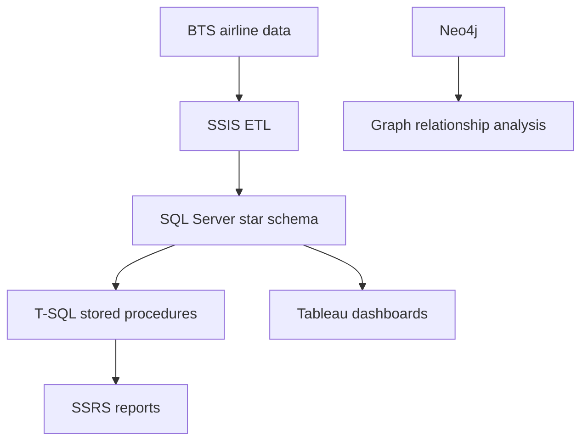
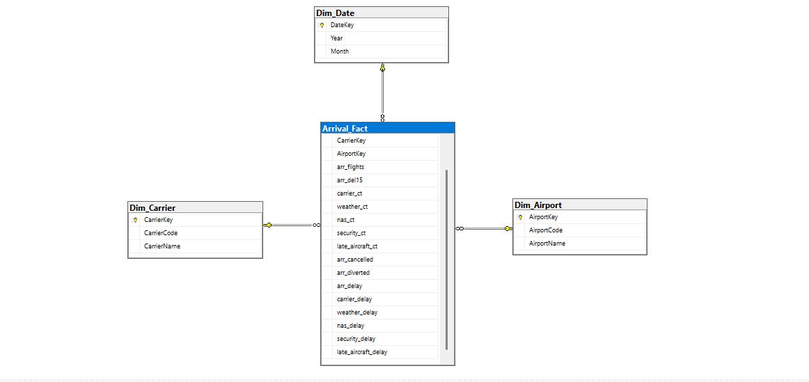
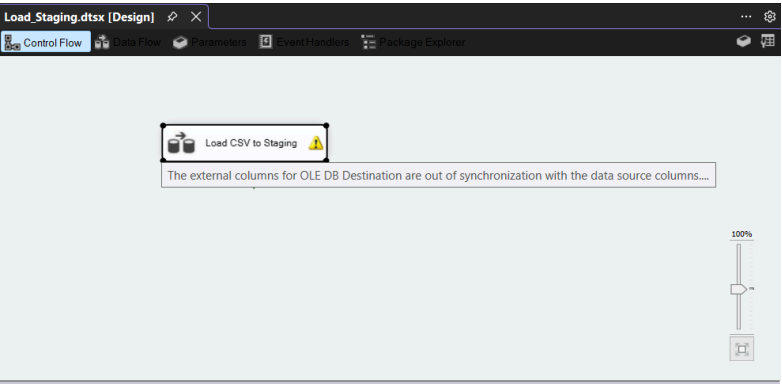
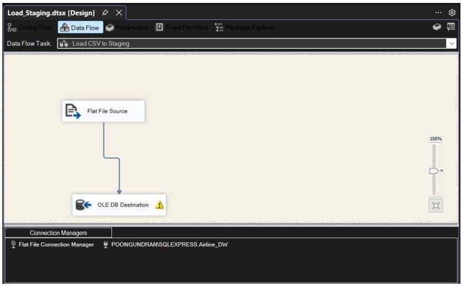
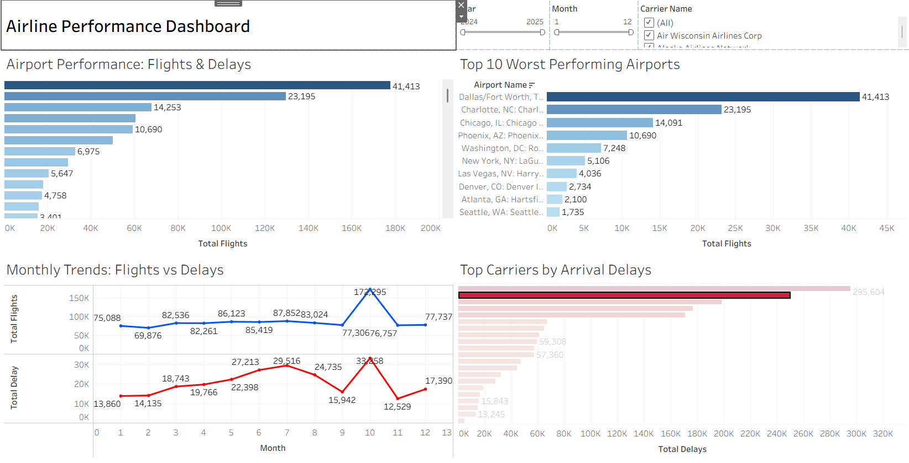
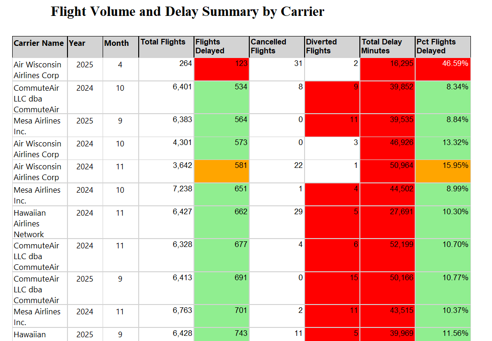
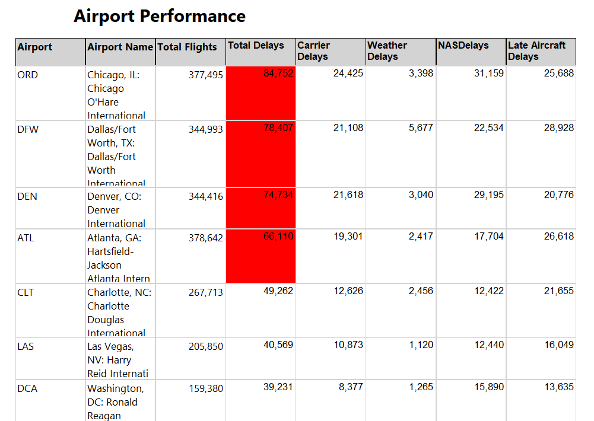
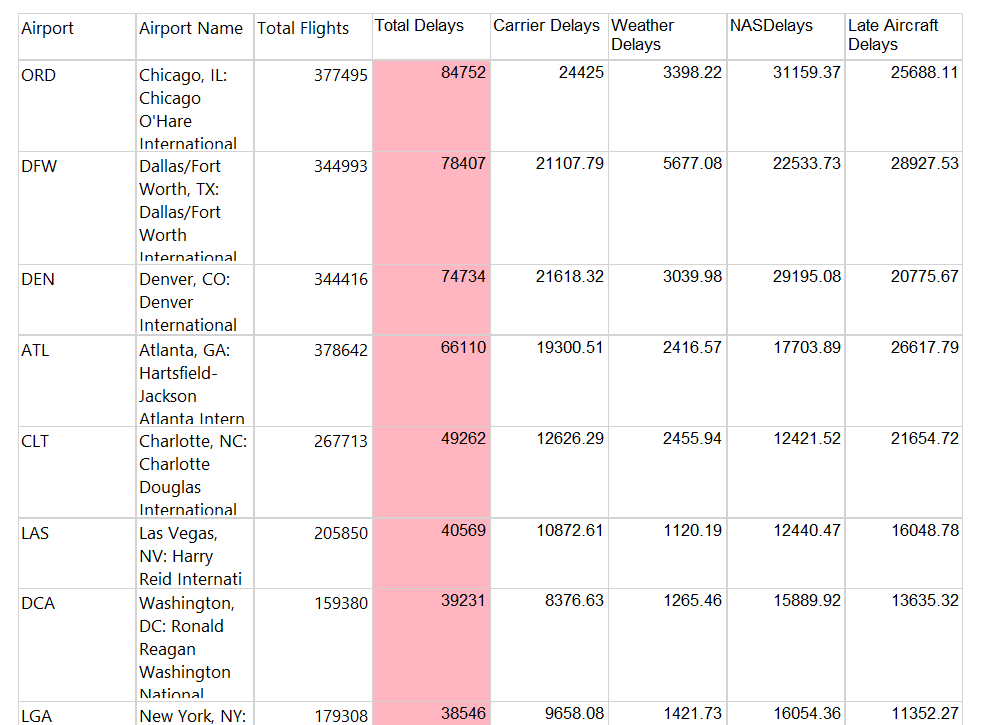
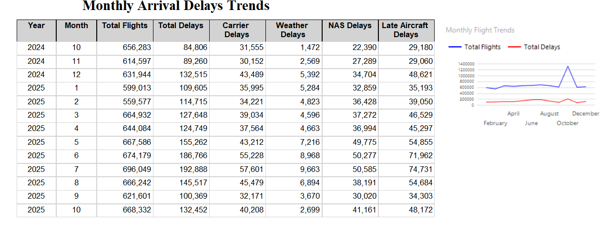
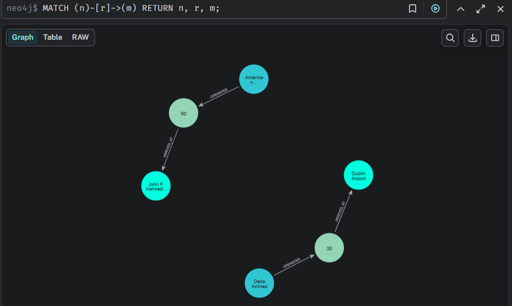

# Airline Data Warehouse & Business Intelligence

An academic data warehousing and business intelligence project using airline on-time performance data from the U.S. Bureau of Transportation Statistics (BTS).

## Project objective

Transform airline operational data into a dimensional data warehouse and deliver analytical reports for evaluating flight delays, airport performance and carrier performance.

## Architecture

The relational warehouse uses monthly aggregated BTS arrival-performance data by carrier and airport, not individual flight records. Neo4j is a separate proof of concept using a small sample rather than the full BTS dataset.

## Technical implementation

| Component | Technology | Purpose |
|---|---|---|
| Data warehouse | SQL Server | Fact and dimension tables organised in a star schema |
| Data integration | SSIS | Extraction, transformation and loading |
| Analytics | T-SQL | Stored procedures and analytical queries |
| Reporting | SSRS | Operational performance reports |
| Visualisation | Tableau | Interactive performance analysis |
| Graph analysis | Neo4j | Relationship exploration |

## Data model and ETL

The warehouse uses a central `Arrival_Fact` table linked to `Dim_Date`, `Dim_Airport` and `Dim_Carrier` through surrogate keys. Raw CSV data is loaded into `Airline_Staging` before transformation. Measures include arrival counts, delayed arrivals, cancellations, diversions and delay causes.

### Star schema

### SSIS control flow

### SSIS data flow

The documented ETL workflow includes null handling, numeric formatting, code mapping and loading dimensions before the fact table. Screenshots show the original academic implementation, not a newly executed pipeline.

## Business intelligence outputs

### Tableau dashboard

The dashboard combines airport performance, airports ranked by total delayed arrivals, monthly trends and carrier comparisons.

### SSRS reports

#### 1. Flight summary by carrier

Stored procedure: `sp_FlightSummaryByCarrier_Report1`. Includes flight counts, delays, cancellations, diversions, delay minutes and delay rate.

#### 2. Airport performance

Stored procedure: `sp_AirportPerformance_Report2`.

#### 3. Top 10 airports by total delays

Stored procedure: `sp_Top10Worst_Report3`.

#### 4. Monthly trends

Stored procedure: `sp_MonthlyTrends_Report4`.

The delay rate is calculated as total delayed arrivals divided by total arrivals, with division-by-zero protection. Rankings by total delays reflect absolute counts, not necessarily the worst delay rates.

## Neo4j proof of concept

The graph demonstrates Carrier–OPERATES–Flight and Flight–ARRIVES_AT–Airport relationships using a small illustrative dataset. It is not a full migration of the relational warehouse.

## Analytical use cases

- Identify the ten airports with the highest total delayed arrivals.
- Compare carrier delay performance.
- Analyse monthly flight and delay trends.
- Explore delay causes including weather, NAS, carrier and security delays.

## Individual contribution

This project was submitted as a group academic assignment at Dublin Business School. My individual contribution covered the end-to-end technical implementation, including the SQL Server warehouse, dimensional modelling, SSIS ETL, SQL queries and stored procedures, SSRS reporting, Tableau visualisation and Neo4j graph analysis.

## Repository guide

The project includes SQL schema and analytical scripts, SSIS ETL materials, SSRS reporting outputs, Tableau visualisation and Neo4j queries. Review the relevant repository files for implementation details.

## Reproduction guide

The following is a suggested workflow, not a verified installation procedure:

1. Obtain the relevant [BTS airline delay-cause dataset](https://www.transtats.bts.gov/OT_Delay/OT_DelayCause1.asp?20=E).
2. Review and execute the warehouse schema scripts in SQL Server.
3. Configure the SSIS source and destination connections and execute the ETL workflow.
4. Review and deploy the analytical stored procedures.
5. Configure SSRS report data sources and open the Tableau workbook.
6. Review the Neo4j queries and configure the required graph data.

Exact software versions, connection settings, dataset filters and execution order require further verification. Do not publish local credentials or connection secrets.

## Acknowledgements

- U.S. Department of Transportation, Bureau of Transportation Statistics (BTS), for the source dataset.
- Dr. Shazia A. Afzal, module supervisor.
- Academic group-project context: Dublin Business School.

Portfolio documentation revised with AI assistance.
