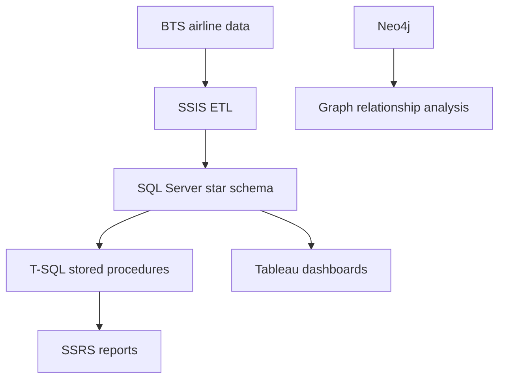

# Airline Data Warehouse & Business Intelligence

An academic data warehousing and business intelligence project using airline on-time performance data from the U.S. Bureau of Transportation Statistics (BTS).

## Project objective

Transform airline operational data into a dimensional data warehouse and deliver analytical reports for evaluating flight delays, airport performance and carrier performance.

## Architecture

The diagram is conceptual; it does not specify the exact graph-data import path.

## Technical implementation

| Component | Technology | Purpose |
|---|---|---|
| Data warehouse | SQL Server | Fact and dimension tables organised in a star schema |
| Data integration | SSIS | Extraction, transformation and loading |
| Analytics | T-SQL | Stored procedures and analytical queries |
| Reporting | SSRS | Operational performance reports |
| Visualisation | Tableau | Interactive performance analysis |
| Graph analysis | Neo4j | Relationship exploration |

## Analytical use cases

- Identify the ten worst-performing airports.
- Compare carrier delay performance.
- Analyse monthly flight and delay trends.
- Explore delay causes including weather, NAS, carrier and security delays.

## Individual contribution

This project was submitted as a group academic assignment at Dublin Business School. My individual contribution covered the end-to-end technical implementation, including the SQL Server warehouse, dimensional modelling, SSIS ETL, SQL queries and stored procedures, SSRS reporting, Tableau visualisation and Neo4j graph analysis.

## Repository guide

The project includes SQL schema and analytical scripts, SSIS ETL materials, SSRS reporting outputs, Tableau visualisation and Neo4j queries. Review the relevant repository files for implementation details.

## Reproduction guide

The following is a suggested workflow, not a verified installation procedure:

1. Obtain the relevant BTS airline performance dataset.
2. Review and execute the warehouse schema scripts in SQL Server.
3. Configure the SSIS source and destination connections and execute the ETL workflow.
4. Review and deploy the analytical stored procedures.
5. Configure SSRS report data sources and open the Tableau workbook.
6. Review the Neo4j queries and configure the required graph data.

Exact software versions, connection settings, dataset filters and execution order require further verification. Do not publish local credentials or connection secrets.

## Acknowledgements

- U.S. Department of Transportation, Bureau of Transportation Statistics (BTS), for the source dataset.
- Dr. Shazia A. Afzal, module supervisor.
- Academic group-project context: Dublin Business School.

Portfolio documentation revised with AI assistance.
